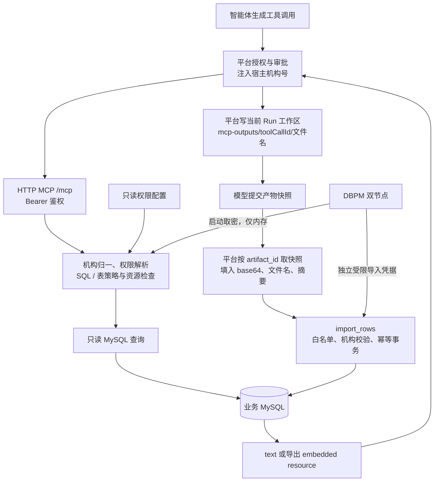

# biz-db-mcp 平台接入与加固实施计划

更新：2026-10-25。状态：设计计划，尚未实施服务代码；当前源码能力不等于本计划的目标能力。

## 1. 范围、依据与优先级

本计划合并既有审查结论、用户确认以及 [平台接入改造需求](平台接入改造需求.md)（R1–R6）。平台通用契约以参考仓库 [MCP Server 接入与开发规范](/Users/eddie/Work/app/pi-enterprise-sandbox/docs/mcp-server-guide.md) 及当前消费者源码为核对依据。

当前范围：

- P0：Streamable HTTP 与 Bearer 鉴权、DBPM 唯一取密、宿主机构号及归一化、只读查询隔离、读取工具与安全基线。
- P1：经 MCP 返回导出文件、白名单产物导入 `import_rows`、持久幂等账本、资源限制与文件交换联调。
- P2：完善稳定错误码与可观测性；其中基础 `text` 结果和脱敏错误应随 P0 一起交付，不能推迟到平台无法使用。
- `execute` / `execute_many` 保持关闭。新增导入是独立、默认关闭的窄写能力，不意味着开放模型手写 DML。
- 本服务不调用 Sandbox API、不持有 Sandbox 凭据；不新增 Sandbox 网络能力、接口或外部访问面。文件搬运由平台 Agent 完成。

### 对旧方案的取代

| 原方案 | 当前决定 |
|---|---|
| 生产 stdio，harness 启动 Python | 生产 Streamable HTTP `/mcp`；stdio 仅本地开发 |
| MCP 直接上传 Dataset，持有 Sandbox token / session 身份 | 删除该链路；MCP 返回文件，平台按当前 Run 写工作区 |
| 适配原始字节上传 `/sessions/:id/datasets` | 作废，不实施旧版第六节的上传接口适配 |
| 导出 100 MiB，独立上传期限 120 秒 | 当前平台单文件回传最多 20 MiB；没有 MCP→Sandbox 上传阶段 |
| 不做任何写入 | 通用 DML 仍关闭；另分 P1 实施默认关闭的白名单产物导入 |
| 机构号直接与配置/表比较 | 先按平台算法归一，再授权与比较，保留原值用于显式 raw 存储场景 |
| 读取工具有宿主参数 | 所有工具，包括将来的导入工具，都使用相同顶层必填 `instituteid` |

补充需求称平台“产物参数 / 文件回传尚在规划”，但通用规范当前已标已实现，且源码已有 `artifactArguments`、`fileResults` 及调用接线。源码核对入口包括 `agent/src/domain/agent/mcp-artifact-arguments.ts`、`agent/src/runtime/policy/artifact-arguments.ts`、`agent/src/runtime/mcp/config.ts`、`agent/src/runtime/mcp/tools.ts` 和 `agent/src/runtime/mcp/file-results.ts`。当前计划按**平台已具备内联路径、部署是否开启需联调确认**处理，不把源码存在写成生产联调通过。`resource_link` 下载仍未实现，单独列为后续阶段；不能把大文件下载当成本轮可用功能。

## 2. 目标链路与职责



平台负责：登录身份、工具授权/审批、宿主参数覆盖、产物归属/交付状态检查、快照搬运、文件回传落盘。MCP 负责：Bearer 身份边界、参数复核、机构隔离、数据库授权与 SQL 安全、文件解析和摘要校验、事务/幂等及脱敏结果。两端都检查，不能只依赖平台过滤模型参数。

## 3. R1：部署、传输与鉴权（P0）

- CLI 增加 `--transport streamable-http`、`--host`、`--port`；生产使用 `/mcp`，本地保留 `--transport stdio`。
- HTTP 使用 `stateless_http=True`，不依赖 MCP session 粘连；每次请求的机构上下文独立，不存共享“当前机构”。鉴权覆盖 MCP 初始化、工具发现、工具调用及适用 HTTP 方法，不能只保护某个工具。
- `BIZDB_MCP_TOKEN` 为服务端 Bearer token；HTTP 模式缺失或空值拒绝启动，缺失/错误 Bearer 返回 401；用常量时间比较，不把令牌写日志。
- 监听与 token 参数必须落实到实际 ASGI/SDK 消费者；实施时核对已安装 MCP SDK 的支持版本并锁定依赖。不得用“签名里加了参数”代替真实 HTTP 验证。
- 容器以数字非 root UID 运行；内部网络部署或经 TLS 反向代理暴露。只有平台持有该服务令牌，机构宿主参数才有可信前提。
- 多副本下限流默认是每实例预算；持久导入账本必须跨副本共享。下载文件的本机状态不在当前阶段引入。
- 将来经统一网关，优先透明路径路由；平台 `id=bizdb`、工具名与宿主参数不变。若网关开放给其他调用方，需隔离凭据或另行设计签名身份，不默认信任自填机构号。

平台清单示例（只有变量名，没有实际令牌）：

```json
{
  "id": "bizdb",
  "url": "https://bizdb-mcp.internal.example/mcp",
  "transport": "streamable-http",
  "authTokenRef": "BIZDB_MCP_TOKEN",
  "timeoutMs": 180000,
  "hostArguments": {
    "instituteid": {"description": "调用者机构号", "source": "user.instituteId"}
  },
  "artifactArguments": {
    "file_base64": {
      "description": "已提交且获准交付的待导入数据产物",
      "modelArgument": "artifact_id",
      "filenameArgument": "filename",
      "sha256Argument": "content_sha256",
      "maxBytes": 10485760,
      "mimeTypes": ["text/csv", "application/x-ndjson", "application/vnd.apache.parquet"]
    }
  },
  "fileResults": {"maxBytes": 20971520}
}
```

这是配置形状示例；平台 Server 清单由 Agent 的 `MCP_SERVERS_JSON` 提供，具体工具仍需管理员在 `enabledTools` 中授权。平台不以 MCP `readOnlyHint` 等 annotations 自动放行：只读工具按平台策略配置，导入工具保留高风险审批。导入/导出未验收前不授权对应工具。

## 4. R2：宿主机构号、读取权限与隔离（P0）

### 4.1 参数与归一化

- `list_databases`、`list_tables`、`describe_table`、`query`、`explain`、`export`、`import_rows`，以及仍保留注册的写工具，都声明顶层、必填、严格字符串 `instituteid`。缺失、空白、控制字符或未知机构拒绝，不能回退全量权限。
- 平台从用户表注入原始值，并删除模型提供的同名值；模型 schema 不显示宿主参数。MCP 仍复核输入。
- 按 `agent/src/domain/identity/institute-code.ts` 对齐归一：先 trim；如果全是 ASCII 数字、长度至少 3，取前两位为 L，L ≥ 1 且总长度恰好 2 + L 时取后 L 位，否则保留字符串。不转成数字，不剥前导零，不反复执行归一算法。
- 示例：`0800001000` → `00001000`；`00001000` → `00001000`。机构策略键、限流键、导入账本键使用归一机构码。
- 输入边界采用平台机构码 64 字符约束；带合法两位长度前缀的原始值最多 66 字符，去前缀后再校验码长。对非法值不猜测修复。
- 原值与机构码分开保留。表策略显式声明 `institution_value_format=code|raw`，默认 `code`；配置为 raw 时绑定本次平台原值，不同时尝试两种写法。raw 存储表需真实账号核对；输入为不带长度位的值时不自行猜测如何补前缀。
- 平台算法存在无前缀值恰好符合长度形状的歧义，不能私自发明不同算法；迁移前列出归一碰撞/重复策略键并拒绝冲突配置，真实账号验收覆盖两类输入。

### 4.2 读取开关和机构范围

- 保留 `BIZDB_READ_ENABLED=true` 与每库 `allow_reads=true` 的交集规则，全局关闭不能由每库重新打开。查询、导出、执行计划与元数据工具统一检查。
- 仅按机构授权，不新增按用户/角色区分的查询权限；平台搬运产物时的用户归属检查是另一层职责。
- 权限配置支持 `self`、`institutions`、`all`。`00001000` 的全机构权限由配置声明，不写死特例；未知机构拒绝。`all` 不绕过数据库准入、工具权限或资源限制。
- 可信策略启动只读加载，修改后重启；请求不写回配置，不做热更新或查询结果缓存。

```json
{
  "institution_scopes": {
    "00001000": {"scope": "all"},
    "00002000": {"scope": "self"},
    "00003000": {"scope": "institutions", "ids": ["00003000", "00003001"]}
  },
  "isolation": {
    "column_candidates": ["ins_id_cd", "instituteid"]
  }
}
```

读取 `all` 不授予跨机构导入。`institutions` 使用归一后的授权码集合；raw 存储表若要支持集合范围，必须有经过核对的码→存储值映射，否则拒绝，不从长度猜值。

### 4.3 表策略与 SQL

- 每张表按 `(database id, schema, table)` 定位，公共表显式配置。非公共表按候选字段的配置顺序，取第一个实际存在的字段；不是按查询输出顺序选，也不在 NULL 时回退其他字段。
- list_databases/list_tables/describe_table 只返回当前机构获准连接和表的元数据，不因是勘探工具而绕过策略；拒绝与不存在保持一致。
- 非公共表没有机构字段或元数据不可访问时拒绝；不自动当公共表。本期不推导父子表机构归属，业务方补字段或单独配置已审核的数据入口。
- 使用 MySQL AST 校验和重写，逐个基础表约束；WHERE 中原有 OR 需正确加括号，机构过滤先于聚合、分页；外连接不能随意在最外层追加 WHERE 破坏语义。
- 单语句 SELECT 为边界。普通 SELECT、聚合、CTE、JOIN、UNION 按实际测试支持，不能可靠改写的形状明确拒绝；视图/函数必须可追溯到已审核范围。
- 禁止可执行注释、文件读写、未审核函数/副作用、锁定读以及修改资源保护的 optimizer hints。字符串中的类似文本不能误判。
- query/export/explain/dry_run 使用同一策略入口；dry_run 返回脱敏的有效范围和限制，不回显原始 SQL/参数，也不能绕过授权。
- 读取采用专用只读事务及最小权限只读账号。结果行数/字节限额在数据库与序列化路径落实；提前终止不先 drain 全量游标。不只靠 regex 拼 WHERE 或 Python 取回后过滤。

## 5. DBPM 唯一取密（P0）

- 保留 provider 接口，用 Python 原生 TCP 实现参考项目协议：`0x0E 0x02` + ` <db_name> <user_name>\n`；只接受严格 UTF-8 的非空 `OK: <password>\n`，禁止密码控制字符，不 trim 密码。
- 条目名为 1–256 UTF-8 字节，不含空白/控制字符；帧上限 4096 字节含换行。连接 3 秒、单端点 5 秒、单次取密总预算 10 秒，使用单调时钟期限，包含解析/建连/读帧；分片、EOF、超长、慢速滴流均受控。
- 复用 `BIZDB_DBPM_SERVERS` 表示两个端点，`dbpm_database` 为条目名，用户必须与对应 DSN 一致。DSN 带密码拒绝；删除关闭 DBPM 后使用明文密码的路径。
- 启动取齐所需凭据，任一必需项失败拒绝启动；密码仅在内存，不写环境、磁盘、工具结果或日志。后续连接只读凭据映射，轮换通过重启生效。
- 默认只取读账号；启用 import 时才取独立受限导入账号。保留现有 `dsn` 给读连接，拟新增 `import_dsn` / `import_dbpm_database` / `import_dbpm_user` 给导入连接，要求指向同一获准的逻辑数据库；不能把导入账号交给任意 SQL 查询工具。
- 导入账号最小权限为白名单表 SELECT/INSERT/UPDATE，以及专用幂等账本所需 DML；无 DDL、无其他业务表写权限。账本 schema 由受控迁移创建，不在服务启动时执行 DDL。
- TCP 实现无协议内 TLS/APP_KEY。目标环境协议和网络保护需部署核对；不把参考项目 fake 验证当作真实 DBPM 验证。

## 6. R3：导出改为平台搬运（P1）

### 6.1 本轮内联路径

1. `export(sql, dataset_name, instituteid, params?, database?, format="parquet")` 执行同一读取隔离策略。
2. 流式生成一个完整本机临时文件；Parquet 根据查询元数据固定 Arrow schema，处理 Decimal 精度、小数位、NULL、无符号数、二进制及空结果，不能依赖前批样本锁定类型。
3. 计算实际文件 SHA-256、大小和行数，确认未截断且满足平台上限，再读取受限大小文件编码为标准 base64，不加 data URI 前缀。
4. 返回 MCP `content` 中的 `resource` 与 `text`。文件名放在 URI 最后一个路径段，安全清洗并正确编码。
5. 平台在启用 `fileResults` 的 Run 中将文件写入 `mcp-outputs/<toolCallId>/<filename>`；模型看到保存说明，blob 不进模型或工具账本。
6. MCP 成功或失败都清理本机临时文件；没有后台下载文件留存，也不调用任何 Sandbox API。

```json
{
  "content": [
    {"type": "text", "text": "文件 orders.parquet；行数 120；格式 parquet；sha256 <64位摘要>；truncated=false；已生成，工作区保存状态由平台确认。"},
    {"type": "resource", "resource": {
      "uri": "bizdb://export/<export_id>/orders.parquet",
      "mimeType": "application/vnd.apache.parquet",
      "blob": "<标准base64>"
    }}
  ]
}
```

URI 用于标识/文件名，不表示模型需要调用 `resources/read` 下载。平台文件落盘失败只产生诊断文本，不一定把整次工具调用改成失败；本服务只承诺“已生成并返回”，不能声称“已保存到 Sandbox”。验收必须检查平台保存说明、路径和回读摘要。

### 6.2 大文件与旧链路删除

- 当前内联硬上限 20 MiB（解码后文件字节），部署可调低，不能配置得超过平台 `fileResults.maxBytes`。超过则 `TOO_LARGE`，不静默截断，不返回平台尚不能下载的链接。
- 补充需求 R3 的大文件 `resource_link` 作为后续 P1b：等平台支持同源下载后，再设计短期签名、一次性消费、容量/TTL 清理、取消、网关同源和多副本存储。尚无消费者时不新增下载端点。
- 删除 `sandbox_client.py`、`load_export_identity`、相关调用/测试及全部 Sandbox 上传配置；不保留 multipart 或原始字节直推 fallback。
- 删除 `BIZDB_SANDBOX_*`、`BIZDB_SESSION_ID`、`BIZDB_ORG_ID`、`BIZDB_USER_ID`、`BIZDB_CONVERSATION_ID`。工作区身份归属由平台当前 Run 决定，不进入本服务导出参数。
- 更新 README / AGENTS：旧的“导出环境身份”和“Dataset 上传”描述需随实施同步修改，本次不提前伪装代码已改。

## 7. R4：受控产物导入 import_rows（P1，默认关闭）

### 7.1 接口与授权

所有参数都在工具 schema 顶层：

| 参数 | 契约 |
|---|---|
| `instituteid` | 必填 string，平台宿主注入，按 §4 归一 |
| `database` | 必填 string，已配置连接 ID |
| `table` | 必填 string，规范化 `schema.table`，必须命中该连接的导入白名单 |
| `file_base64` | 必填 string，平台从产物快照填入的标准 base64 |
| `filename` | 必填 string，平台填入，安全文件名，不接受路径或 URL |
| `content_sha256` | 必填 string，64 位小写十六进制，解码后的文件摘要 |
| `format` | 可省略；csv/jsonl/parquet，按扩展名推断并核验内容，冲突拒绝 |
| `mode` | 必填 insert/upsert，只能使用该表允许模式 |
| `dry_run` | bool，建议默认 true；false 才进入获授权的事务写入路径 |

平台模型侧只提供 `artifact_id`、获准目标和导入选项；平台在执行时替换成快照字节/文件名/摘要。MCP 不接受本地路径、任意 URL，不从 Sandbox 拉文件。平台负责产物归属及 released 状态，MCP 再次做摘要与业务范围校验。

- `BIZDB_IMPORT_ENABLED=false` 为独立导入开关，另需每库 `allow_imports=true`、匹配表白名单、机构导入授权和受限账号；多者同时成立才开放导入。开关不绕过其他准入。
- 机构白名单新增 `allow_imports`（默认 false），与读取 `scope` 分开。`all` 或 `institutions` 的读取权限不授予跨机构写入；本期所有导入只写调用者自己的机构码/显式存储原值。
- 即使导入开启，`BIZDB_WRITE_ENABLED=false`，`execute` / `execute_many` 仍禁用且平台不授权。普通查询继续使用读账号。

白名单示意（按连接 ID 和完整表名定位）：

```json
{
  "imports": {
    "primary:app.report_results": {
      "modes": ["insert", "upsert"],
      "key_columns": ["report_date", "branch_code"],
      "columns": ["report_date", "branch_code", "metric", "value"],
      "institution_column": "ins_id_cd",
      "institution_value_format": "code",
      "max_rows": 50000
    }
  }
}
```

以上只说明配置形状，不代表任意同名表都可安全 upsert，唯一约束还必须通过下面的检查。

### 7.2 文件解析与机构约束

- 解码前检查 base64 长度，严格解码后检查文件大小与 SHA-256，再按格式解析；拒绝非规范编码、data URI、压缩炸弹式展开、异常行数/列数/单字段及不支持类型。Parquet 读批次与解析内存同样受限，不能只限制压缩文件大小。
- CSV/JSONL/Parquet 的文件列只能是白名单 columns 加可校验的 institution_column；重复列、未知列拒绝。必要列不能因“子集允许”而缺失：结合 NOT NULL / 默认值 / 生成列元数据校验。
- 服务端注入机构列；文件已含该列时每行必须匹配本次绑定值，否则整批拒绝。缺省/NULL 不能被当作跨机构或公共数据绕过。
- 按目标字段类型做严格校验，禁止 MySQL 静默截断、数值溢出及丢前导零转换；标识符来自配置/已验证元数据，值始终参数绑定。
- 预检与正式执行使用相同解析/授权路径；dry_run 不写业务表、不写幂等账本，只返回可写行数、列及错误行号/字段/原因。问题样例不包含单元格原值。
- 仅 InnoDB 基表，拒绝未审核视图/触发器/跨机构级联路径；同一文件全量验证后再进入写事务，不能边验证边提交。

### 7.3 事务、upsert 和持久幂等

- 一次导入一个事务、全部成功或回滚；行数超限整批拒绝，不截断写入。服务端不自动重放已发出的写 SQL。
- `upsert` 的有效业务键包含机构列；必须核对表上参与本次导入的 UNIQUE/PRIMARY KEY 冲突路径。若全局唯一约束可能命中其他机构，先拒绝该表 upsert，完成 schema 整改/审核后才开放；不能只在插入值里补机构号就使用无条件 ON DUPLICATE KEY UPDATE。
- 并发冲突的判断必须在正确的锁/唯一约束及同一事务下完成，避免先查后写的竞态；外键涉及的非公共数据同样需要机构归属检查。
- 幂等键固定为 `(normalized instituteid, database id, canonical schema.table, content_sha256, mode)`；以数据库唯一约束持久记录，不用进程内缓存或本机文件充当账本。
- 幂等账本与业务 DML 在同一 MySQL 事务提交；DBA 预置 InnoDB 账本和所需索引，schema 缺失拒绝启用导入。权限检查发生在返回 duplicate 之前，不能泄漏别的机构批次。
- 多副本/并发重复导入只允许一批产生副作用；其余返回 duplicate 或明确繁忙。事务提交后的响应丢失，重试同一键取得已提交结果；提交前崩溃则两者一并回滚。
- 若超时/断线时提交结果不明确，返回脱敏的 `IMPORT_OUTCOME_UNKNOWN` 与可用批次标识（如果响应仍可达），不能谎报已回滚。平台重试同一内容依赖持久账本确认，MCP 不盲目重放。
- 返回 text 摘要及可选结构化副本：`status=imported|duplicate|dry_run`、准确插入/更新行数、批次 ID；计数不能简单由 MySQL upsert affected_rows 推算，应有可验证的统计路径。不确定时不编造。

## 8. R5：资源与调用期限

默认平台 `timeoutMs=180000`。服务端端到端工具期限 150 秒，低于平台超时；读取/导出/导入各阶段都消费同一剩余预算，取消需传递到数据库/解析/文件处理，不允许串行阶段各用满预算后总计超过平台期限。预计更长任务另行设计提交/状态工具，本期不默认异步执行。

| 范围 | 默认限制 / 行为 |
|---|---|
| query | 200 行、结果数据序列化 UTF-8 1 MiB、10 秒；明确标记行数/字节截断；单行过大不截坏字段 |
| export | 100,000 行、解码后文件最多 20 MiB、生成期限 120 秒且受 150 秒端到端期限约束；超限整体失败，truncated=false 才回传 |
| import_rows | 文件原始字节最多 10 MiB；base64 字符串最多 13,981,016 ASCII 字节；最多 50,000 行且服从更小表级上限；解析/事务工作预算 120 秒，受端到端期限约束 |
| HTTP 请求体 | 初始上限 16 MiB，给 10 MiB 文件 base64 和 JSON 留空间；在完整 JSON 解码前限制；网关/代理同步配置 |
| HTTP 导出响应 | 20 MiB 文件对应 base64 最多 27,962,028 字节，另加 MCP JSON；部署响应上限/内存预算不能误按 20 MiB 配置 |
| 并发 | 单进程执行中总数 4、同机构 2、全进程 export 1、import 1；均计入总数；超额明确繁忙，不无限排队 |
| 速率 | 每归一机构持续 60 次/分钟，突发 10 次；all 不豁免；多副本需平台/网关统一预算或明确按实例配置 |

所有大小单位均为二进制 MiB。平台 artifactArguments.maxBytes 应不高于 MCP 原文件上限，fileResults.maxBytes 应不低于 MCP 实际导出上限，两者与工具描述一致。还需设置解析展开字节、最大列数、单字段大小和 Arrow 批次内存的界限，在实施前以负载夹具确定；未设可验证内存界限前不验收导入。

## 9. R6：结果、错误与审计

- 每个成功/失败结果都有 `content.text`；structuredContent 只能作为副本，不是唯一返回路径。查询 text 含 rows、行数、有效限制、truncated 与原因，不能回显原 SQL/参数。
- 失败用 `isError=true` 与稳定错误码，例如 `FORBIDDEN_INSTITUTION`、`RESOURCE_NOT_ACCESSIBLE`、`TABLE_NOT_IMPORTABLE`、`CONTENT_DIGEST_MISMATCH`、`TOO_LARGE`、`RATE_LIMITED`、`DEADLINE_EXCEEDED`、`IMPORT_OUTCOME_UNKNOWN`。具体代码在接口实现前固定。
- 对外跨机构拒绝与资源不存在使用一致响应；已知不可导入表也不能泄露其他机构/库的存在信息。内部可记录脱敏分类，不向模型返回堆栈或数据库原始异常。
- 审计只记录请求 ID、归一机构码、工具、获准数据库/表、策略版本、摘要、长度、行数、状态、耗时和稳定错误类别；不得记录 SQL、参数、凭据、原始数据、base64 或单元格问题原值。
- stdout 只用于本地 stdio MCP 协议；HTTP/stdio 诊断均走脱敏日志。HTTP 服务器默认 access/error 日志也要检查，不能绕过审计脱敏。

## 10. 配置、迁移与模块责任

新增/调整配置（均为计划字段，实施时在 README / .env.example / 工具描述同步记录）：

| 配置 | 行为 |
|---|---|
| `--transport` / `--host` / `--port` | 生产 streamable-http；本地 stdio；明确 /mcp 路径 |
| `BIZDB_MCP_TOKEN` | HTTP 必需，缺失拒启；平台通过同名 authTokenRef 引用 |
| `BIZDB_ACCESS_POLICY_FILE` | 新增必需的机构/表策略 JSON 文件；只读启动加载，修改需重启 |
| `BIZDB_READ_ENABLED` / 每库 `allow_reads` | 默认 true，取交集 |
| `BIZDB_IMPORT_ENABLED` / 每库、机构 `allow_imports` | 默认 false，取交集并检查表白名单；与通用 DML 分开 |
| `BIZDB_WRITE_ENABLED` / 每库 `allow_writes` | 平台实例必须保持关闭；不允许用它启用任意 SQL 写入 |
| `BIZDB_DATABASES_JSON` / `BIZDB_DATABASES_FILE` / 无密码 DSN | 保留连接目录；新增可选独立导入连接凭据声明 |
| `BIZDB_DBPM_SERVERS` / DBPM 超时配置 | 两个受控端点；保留现有命名并做严格端点校验 |
| `BIZDB_EXPORT_INLINE_MAX_BYTES` | 默认/最大 20 MiB，可调低，和平台 fileResults 一致 |
| `BIZDB_IMPORT_MAX_BYTES` | 默认/最大 10 MiB，按解码前后双重约束 |
| 查询/导出/导入行数、期限、字节/解析内存/并发/速率 | §8 默认；新增变量在实施阶段逐一登记，模型不可上调 |

迁移清单：

- 旧 Sandbox 上传环境变量全部删除，发现旧配置给出不回显值的迁移诊断；不要求配置 Sandbox token 才能查询。
- 旧 DBPM Java 桥接的 COMMAND/APP_NAME/APP_KEY/APP_IP 不属于目标 TCP 协议；切换时给明确迁移诊断。`BIZDB_DBPM_ENABLED=false` 不再允许明文路径。
- 所有工具增加 required instituteid，是 MCP 参数兼容性变化；平台 hostArguments 同步部署。严格 schema 测试验证顶层 required/string。
- export 从普通 Dataset dict 改为 `text + embedded resource`，不再承诺 dataset_id 或 stored_relative_path；工作区路径由平台返回保存说明。
- query/dry_run 返回不回显 SQL/参数的 text 结果，需要更新现有返回形状测试和调用文档。
- 启用导入前完成账号授权、机构复合唯一约束审核、导入账本迁移；没有这些前置条件不得打开 import。
- 当前 AGENTS.md、README 中的 stdio-only、桥接、Sandbox 上传和写保护表述随对应生产改造一起同步，不在纯计划阶段提前声明已实现。

建议模块边界：

- `server.py`：工具 schema、MCP content、CLI/传输注册；HTTP 鉴权可单独放 `transport.py`。
- `config.py` / `startup.py`：配置快照、启动检查、DBPM 凭据装配。
- `institution.py` / `policy.py`：原值与归一码、机构范围、表/导入白名单；不与 SQL/HTTP 混合。
- `sql_guard.py`：AST 准入、机构重写、结果限制；`db.py`：只读连接/元数据/早停。
- `export.py`：文件生成与元数据 schema；`mcp_files.py`：受限文件→embedded resource，不含 Sandbox 客户端。
- `import_rows.py` / `import_ledger.py`：文件校验、受控事务和持久幂等；删除 `sandbox_client.py`。

## 11. 分阶段实施与交付门槛

1. **P0-A 传输与配置**：真实 HTTP `/mcp`、Bearer、无状态、非 root 部署；保留本地 stdio；缺失配置 fail closed。
2. **P0-B 身份与只读隔离**：归一/宿主 schema、只读策略/SQL 加固、DBPM 启动取密、读取与资源基线；先授权六个读取工具中已验收的部分，export 暂不授权。
3. **P1-A 文件导出**：移除 Sandbox 依赖，接通内联资源与平台 fileResults，验证工作区回读与摘要，再授权 export。
4. **P1-B 受控导入**：部署账号与账本、白名单/解析/机构/唯一约束、dry_run、事务及幂等，再启用 import 并配置平台产物映射与审批。通用 DML 仍关闭。
5. **P1b 后续大文件链接**：等待平台 resource_link 下载消费者落地再定下载端点/凭据/多副本设计，不作为当前上线依赖。
6. **P2 可观测性完善与容量验证**：在基础 text/脱敏结果已具备前提下完善指标与运维演练；真实联调未通过的阶段不能标记完成。

并行实现须明确文件所有权及连接/上下文/MCP 返回接口；共享 `server.py`、`config.py`、`db.py` 串行整合，多个写 worker 使用独立 worktree。主代理复核结果，不把 worker 自述当验收证据。当前只更新计划，不派实现任务、不改平台或本服务生产代码。

## 12. 验收矩阵与追踪

| 需求 | 本计划落点 | 必需验证 |
|---|---|---|
| R1 | §3、§8 | 真实 HTTP initialize/tools/list/tools/call；无/错 token 拒绝；缺 token 拒启；正确 token 可用；无状态并发与网关大小/超时配置 |
| R2 | §4 | 每工具顶层 required/string；模型覆盖攻击；带长度位/不带长度位同码；前导零、歧义/碰撞、未知机构拒绝；真实账号核对；并发 A/B 不串范围 |
| R3 | §6 | embedded blob 标准 base64、URI 末段文件名、text 元数据；启用/禁用 fileResults；20 MiB 边界；平台落盘失败诊断；Run 工作区实际回读且 SHA-256 一致；没有 Sandbox 出站调用/凭据 |
| R4 | §7 | 平台模型只见 artifact_id；已交付与越权产物对照；dry_run 无写；类型/未知列/错误摘要/异机构整批拒绝；InnoDB 回滚；跨机构唯一键冲突与并发 upsert 拒绝；持久 duplicate、多副本、提交响应丢失/进程崩溃重试后只写一次 |
| R5 | §8 | 解码前后大小、JSON 请求体、压缩/解析展开、内存、行数、期限、取消、连接/文件释放；服务端先于 180 秒平台期限结束；不把读超时当服务端 DML 已撤销 |
| R6 | §9 | 每结果均含 text；structuredContent 省略仍可用；稳定错误码/isError；不存在与跨机构一致；日志/错误不含凭据、SQL、base64 或业务值 |

原六项审查问题的去向：可执行注释/SELECT 副作用进入 §4；游标早停与 Parquet schema 进入 §4/§6；任意 DML 跨库和非事务回滚风险通过关闭 execute/execute_many 暂不开放，导入用 §7 的精确表白名单、受限账号、InnoDB 和幂等事务处理，而非继续扩张任意 DML 解析。

验证层次：先本地单元与真实 loopback HTTP/TCP 测试，再一次性 MySQL 的事务/权限/并发验证，最后平台真实用户的端到端工具调用与产物/文件回读。不得对生产数据库、真实 DBPM 或生产 Sandbox 做未授权测试；部署连通性使用获授权的测试条目与会话。此次计划修订只核对文档和源码，未执行上述集成验证；此前 26 项单测通过不是新方案验收结论。

需联调/业务确认的剩余项：真实 UAuth 值及 raw 存储表映射、实际目标 DBPM 协议、导入表 schema/复合唯一约束与账号、平台实际部署是否已启用文件交换、解析内存预算。跨机构导入与大文件下载均默认不开放；不因缺少确认而降级放行。

## 13. 实施前复核修订（2026-10-25）

开工前对照源码与平台规范复核本计划，发现以下问题并按此实施；与前文冲突处以本节为准。

| # | 问题 | 修订 |
|---|---|---|
| 1 | FastMCP 对同步工具直接在事件循环里调用（`func_metadata.call_fn_with_arg_validation` 中 `fn(**args)`），HTTP 多用户下一条慢查询会阻塞全部请求，§8 的并发预算形同虚设 | 所有工具改为 async，阻塞体经 `anyio.to_thread` 执行；准入（并发槽、速率）在线程内持有，直到线程真正结束才释放；端到端期限用 `anyio.fail_after`，超时返回 `DEADLINE_EXCEEDED`（导入返回 `IMPORT_OUTCOME_UNKNOWN`） |
| 2 | §4.3 只说“AST 改写并在 WHERE 追加条件”，OR、外连接、聚合语义都要逐类处理，易错 | 改为**表替换**：每个真实基表引用 `T AS a` 替换为 `(SELECT * FROM schema.T WHERE col IN (...)) AS a`，过滤先于任何使用发生，OR/外连接/聚合/子查询/UNION/CTE 无需特判；用 sqlglot `traverse_scope` 识别基表与 CTE，未分类的表节点一律拒绝 |
| 3 | sqlglot 把 MySQL 可执行注释 `/*! ... */` 和优化器提示 `/*+ ... */` 当普通注释，原 regex 守卫同样漏掉 | SQL 中出现**任何注释**即拒绝 |
| 4 | sqlglot 不能解析 pymysql 的 `%s`；且 pymysql 传参时对整条 SQL 做 `%` 格式化，`LIKE 'a%'` 会出错（现有代码已有此缺陷） | 解析前把字面量外的 `%s` 转为占位符，生成后按 token 位置还原为 `%s`、其余 `%` 转义为 `%%`，并按占位符出现顺序重排参数（过滤值插在 SQL 中间） |
| 5 | 读取 `query` 依赖客户端早停，`SSCursor.close()` 会读完剩余结果集 | 在 SQL 层加 `LIMIT`（limit+1，用于判定截断），由 MySQL 停止产出；字节上限在序列化时执行 |
| 6 | §7.3 upsert 只要求“业务键包含机构列”，但表上**任何**不含机构列的唯一索引都可能让 `ON DUPLICATE KEY UPDATE` 命中他机构行 | 要求表上每个 UNIQUE/PK 都含机构列，且 `key_columns + 机构列` 恰好等于某个唯一索引；否则该表拒绝 upsert。插入/更新行数用同事务内 `SELECT ... FOR UPDATE` 统计已存在键，不从 affected_rows 推算 |
| 7 | 保留注册的 `execute` / `execute_many` 带 `instituteid` 但不做机构隔离，平台若误授权即越权写 | 通用 DML 仅限本地 stdio 开发：`writes.enabled` 在 streamable-http 下拒绝启动，且只有开启时才注册这两个工具 |
| 8 | FastMCP 在 host 为 127.0.0.1（默认）时自动开启 DNS rebinding 防护、仅放行 localhost，经反向代理/网关部署会被 421 拒绝 | 配置 `server.allowed_hosts`；未配置时关闭 Host 校验，以 Bearer 为边界 |
| 9 | 用户要求配置对人友好：十余个 `BIZDB_*` 环境变量与 JSON 字符串难以维护 | 改为单一 `config.yaml`（`--config` / `$BIZDB_CONFIG` / `./config.yaml`），严格拒绝未知键；文件内不放秘密：Bearer 由 `server.auth_token_env` 指定的环境变量提供，数据库口令只来自 DBPM；`password_env` 仅限 DBPM 关闭的本地 stdio。检测到旧环境变量时拒绝启动并列出变量名（不回显值） |
| 10 | YAML 会把未加引号的 `00001000` 解析成整数并丢前导零 | 机构码键必须是字符串；带长度位的原值写进配置直接拒绝 |
| 11 | 读账号可能能访问同实例其他 schema | 只允许 DSN 所在 schema；其他 schema 的表必须在 `isolation.tables` 显式配置 |
| 12 | 驱动异常文本可能含列值/SQL 片段 | 对外只返回稳定错误码 + MySQL 错误号与固定提示；1146/1142 等映射为与跨机构一致的 `RESOURCE_NOT_ACCESSIBLE` |

本轮实施范围：P0 全部、P1-A 内联导出、P1-B `import_rows`（默认关闭）。`resource_link` 大文件下载仍不实施。
